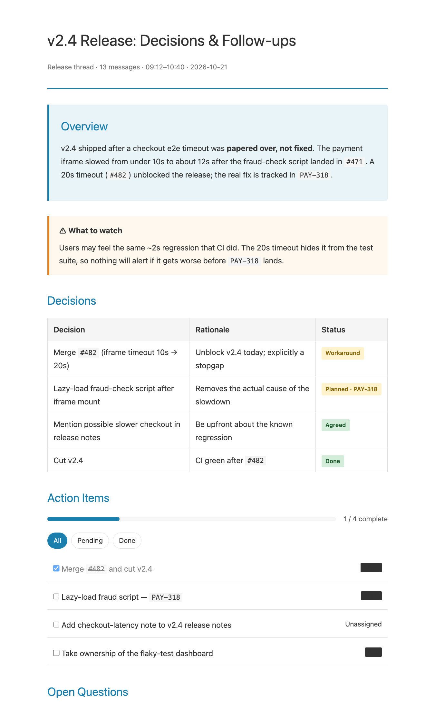
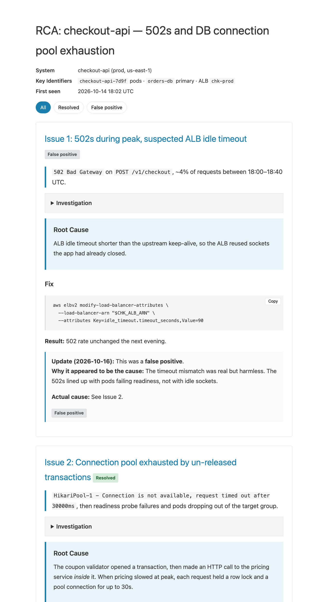

<h1 align="center">dev-kit</h1>

<p align="center"><strong>Four Claude Code skills for the engineering chores you do every week: opening PRs, turning walls of text into readable pages, writing RCAs, and prompting Chrome extensions into existence.</strong></p>

<p align="center">One install command. Plain-markdown skills you can read, fork, and change.</p>

---

## Why this exists

Most of an engineer's week isn't writing code. It's the wrapper work: the PR description, the post-incident write-up, the Slack thread nobody will reread. AI assistants can do that work, but out of the box they do it generically. You get a different shape every time, important detail gets lost, and it's never quite what your team expects.

A skill fixes that by writing the method down once: the steps, the output contract, and the guardrails. Your assistant then follows it every time you say "raise a PR" or "write RCA". This repo collects the ones we use daily.

## See it

**`html-render`**: a messy 13-message release thread becomes a page that answers *"what do I need to do?"*. It extracts decisions and owners, flags the risk the thread glossed over, and lists the open questions. Names are redacted until you hover over them.

<p align="center"></p>

<sub>Input: <a href="examples/html-render/release-thread.md"><code>examples/html-render/release-thread.md</code></a> → output: <a href="examples/html-render/release-thread.html"><code>release-thread.html</code></a> (open it; the filters and checkboxes work)</sub>

**`rca`**: a living incident document. When the first diagnosis turns out wrong, the skill doesn't erase it. It adds a dated *false positive* Update and links to the real cause. Dead ends stay in the record because they save the next on-call person an hour.

<p align="center"></p>

<sub>Sample: <a href="examples/rca/rca-checkout-api.html"><code>examples/rca/rca-checkout-api.html</code></a></sub>

**`chrome-extension-prompter`**: one sentence in, a build prompt Claude Code can one-shot out. The prompt bakes in the Manifest V3 traps (no `setInterval` in service workers, `chrome.idle`, window focus events) and spends most of its words on design.

```
> I want a chrome extension that tracks how much time I spend on each site
  and nudges me when I'm on Twitter too long

Build me a Chrome extension (Manifest V3) called "Hourglass" — a quiet, honest
record of where my browsing time actually goes, with a gentle nudge when I'm
overdoing one site.

MILESTONE 1 — get this fully working first:
- Track time per domain using tab/window focus events and chrome.idle (~60s
  threshold); persist timestamps to chrome.storage.local and compute durations
  from them — no setInterval (service workers get suspended).
  ...
DESIGN DIRECTION — this matters as much as the functionality:
- The popup is the heart of the product. ...
```

<sub>Full run: <a href="examples/chrome-extension-prompter/tab-time-tracker.md"><code>examples/chrome-extension-prompter/tab-time-tracker.md</code></a></sub>

**`raise-pr`**: say "raise a PR". It branches off `main` if you're on it, writes a conventional commit, pushes, and opens a PR with Summary, Motivation, Changes, and How to test filled in from the actual diff. It also handles cherry-picks: it mirrors the original PR body and resolves conflicts without silently dropping code.

> Samples are illustrative: fictional inputs, with outputs produced by following each skill's instructions.

## Use it

**Claude Code (recommended):** install the whole kit as a plugin.

```bash
claude plugin marketplace add ritvikneu/dev-kit
```

```
/plugin install devkit@devkit
```

Skills then trigger on their own ("raise a PR", "make this HTML", "write RCA", "chrome extension for…") or as slash commands: `/raise-pr`, `/html-render`, `/rca`, `/chrome-extension-prompter`.

Update later with `/plugin update devkit`. To hack on it locally, run `claude --plugin-dir /path/to/dev-kit`.

## The skills

| Skill | Say | What you get |
|---|---|---|
| [`raise-pr`](skills/raise-pr/SKILL.md) | "raise a PR", "cherry-pick this" | Branch → conventional commit → push → PR with a full description. Never force-pushes, never stages secrets. |
| [`html-render`](skills/html-render/SKILL.md) | "make this HTML", "visualize this" | A single self-contained `.html` file for any content: docs, diffs, PRs, Jira tickets, chats, todos. Classifies content into 11 categories, each with its own layout. |
| [`rca`](skills/rca/SKILL.md) | "write RCA", "update RCA" | An append-only HTML RCA: symptom → investigation → root cause → runnable fix, plus Runbook and Learnings. Corrections become dated Update blocks. |
| [`chrome-extension-prompter`](skills/chrome-extension-prompter/SKILL.md) | "chrome extension for…" | Feasibility check, then a named, milestone-scoped build prompt with MV3 constraints from a [per-type playbook](skills/chrome-extension-prompter/references/mv3-playbook.md). |

## The recipe: how these skills are built

Every skill here follows the same five-part shape. Copy it to write your own.

1. **A description that does the triggering.** The frontmatter `description` says what the skill does *and* the exact phrases that should invoke it ("raise a PR", "write RCA"). Assistants decide whether to load a skill from this one line.
2. **A numbered workflow, not vibes.** Inspect → decide → act → report. `raise-pr` checks git state before choosing a branch name; `rca` always reads the existing file before writing a word.
3. **An output contract.** Exact structure, not "make it nice": `rca` maps every section to specific HTML elements, and `chrome-extension-prompter` fills a fixed prompt template. The output stays the same shape no matter who asks or how.
4. **Opinions that add value.** `html-render` refuses to re-dump what Jira already shows and redacts names by default. `rca` treats learnings as principles, not incident trivia. `chrome-extension-prompter` gives design at least as many words as functionality.
5. **Guardrails and an eval.** Explicit "never" rules (force-push, overwrite unread files, stage `.env`), plus an `evaluations/*.json` per skill listing the expected steps and success criteria.

Shared HTML styling lives once in [`html-render/references/TEMPLATES.md`](skills/html-render/references/TEMPLATES.md); `rca` symlinks to it.

## Install individual skills

**Any agent, via the [skills CLI](https://www.npmjs.com/package/skills):**

```bash
npx skills add ritvikneu/dev-kit                    # pick from the list
npx skills add ritvikneu/dev-kit --skill raise-pr    # or just one
```

**Claude Code, by hand:**

```bash
BASE=https://raw.githubusercontent.com/ritvikneu/dev-kit/main/skills

# raise-pr (single file)
mkdir -p ~/.claude/skills/raise-pr && curl -fsSL $BASE/raise-pr/SKILL.md -o ~/.claude/skills/raise-pr/SKILL.md

# html-render (+ templates)
mkdir -p ~/.claude/skills/html-render/references \
  && curl -fsSL $BASE/html-render/SKILL.md -o ~/.claude/skills/html-render/SKILL.md \
  && curl -fsSL $BASE/html-render/references/TEMPLATES.md -o ~/.claude/skills/html-render/references/TEMPLATES.md

# rca (templates come from html-render; the repo copy is a symlink)
mkdir -p ~/.claude/skills/rca/references \
  && curl -fsSL $BASE/rca/SKILL.md -o ~/.claude/skills/rca/SKILL.md \
  && curl -fsSL $BASE/html-render/references/TEMPLATES.md -o ~/.claude/skills/rca/references/TEMPLATES.md

# chrome-extension-prompter (+ MV3 playbook)
mkdir -p ~/.claude/skills/chrome-extension-prompter/references \
  && curl -fsSL $BASE/chrome-extension-prompter/SKILL.md -o ~/.claude/skills/chrome-extension-prompter/SKILL.md \
  && curl -fsSL $BASE/chrome-extension-prompter/references/mv3-playbook.md -o ~/.claude/skills/chrome-extension-prompter/references/mv3-playbook.md
```

**claude.ai:** zip a skill folder (for example `skills/rca/`, with `references/TEMPLATES.md` copied in place of the symlink) and upload it under **Settings → Capabilities → Skills**.

**Other assistants (Cursor, Copilot, Windsurf…):** paste the skill's `SKILL.md` into your rules or custom instructions file.

Then just ask: *"raise a PR for these changes"*.

**No skills support at all?** Paste this prompt:

```
Read https://raw.githubusercontent.com/ritvikneu/dev-kit/main/skills/rca/SKILL.md
and follow it exactly to write an RCA for the incident we just debugged.
```

## Where it earns its keep

- **End of a debugging session:** `/rca` captures the fix *and* the dead ends while they're fresh.
- **Monday catch-up:** paste a weekend Slack thread into `/html-render` and get decisions, owners, and open questions.
- **Reviewing a big PR:** `/html-render <PR URL>` summarizes per change group and flags risks instead of re-rendering the diff.
- **Friday-afternoon idea:** `/chrome-extension-prompter` turns it into a prompt you can build in one sitting.

## Contributing

PRs welcome, including improvements to existing skills. A new skill goes in `skills/<name>/` with a `SKILL.md` (`name` + trigger-rich `description` frontmatter), at least one `evaluations/*.json` (see [`rca`'s](skills/rca/evaluations/rca-document-creation.json) for the format), and optionally `references/`. HTML-producing skills should symlink `references/TEMPLATES.md` from `html-render` instead of duplicating CSS. Use one branch per skill (`skill/<name>`) and PR into `main`.

## License

[MIT](LICENSE). html-render is inspired by [The unreasonable effectiveness of HTML](https://thariqs.github.io/html-effectiveness/).
